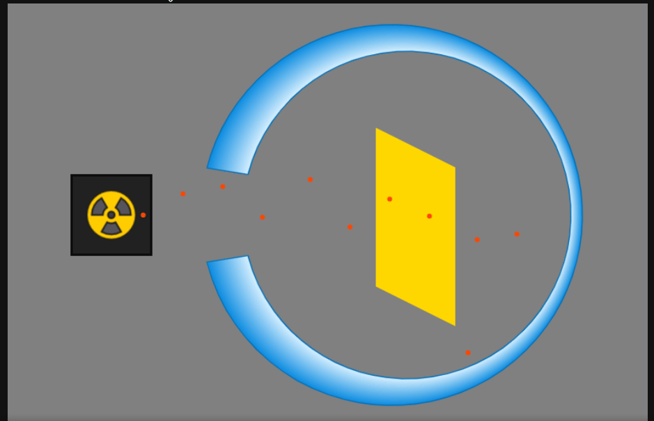

## An interactive simulation of Rutherford’s gold foil

This is an interactive simulation of Rutherford's gold foil experiment. It helps you visualize the experiment better and explore different parameters to see how the experiment would behave if there were no nucleus, as Thomson model assumed. built with HTML canvas and vanilla JavaScript



### What parameters you can change
- Atomic model: Switch between Thomson's plum pudding model and the nucleus model, which Rutherford assumed.
- Foil thickness: A thicker foil means more atoms, which means more nuclei and more bending.
- Number of particles: Decrease it to follow a single particle, or increase it to see how particles behave as a group.

### How to run it locally
- Clone the repo or download the ZIP folder directly from GitHub:

  ```bash
  git clone https://github.com/AmrGamalbit/rutherford-gold-foil-experiment
  ```

- Open the project folder on your device.
- Double-click on `index.html`.
